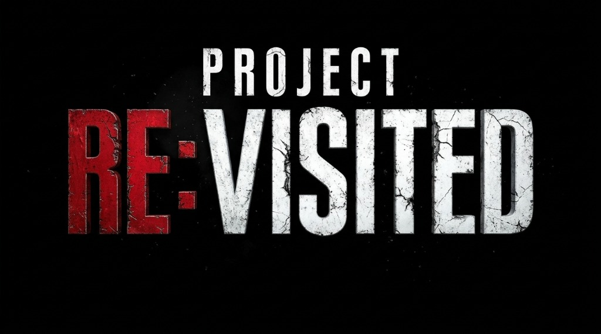

<p align="center">
  
</p>

# Project RE: Visited - Resident Evil 3

**🌎 Languages / Idiomas**: [**English**](README.md) | [Português (Brasil)](README.pt-br.md) | [Español](README.es.md)

---

**☣️ Native C/C++ x86_64 PC Port & Clean-Room Static Recompilation of Resident Evil 3: Nemesis (1999, PlayStation 1) for Windows**

---

##☣️ The Project RE: Visited Initiative

**Project RE: Visited** is an independent, open-source preservation initiative dedicated to restoring, modernizing, and preserving the seminal PlayStation 1 survival horror trilogy natively on PC:
* **Resident Evil 3: Nemesis** (Inaugural Release)
* **Resident Evil 2** (Planned)
* **Resident Evil** (Planned)

Our mission is to deliver the definitive experience of these historic classics on contemporary hardware—combining authentic artistic fidelity with modern quality-of-life (QoL) enhancements, true 360° analog 3D controls, ultra-smooth frame rates (up to 240 FPS / host refresh), and resolutions up to 4K UHD—without relying on traditional emulators or dated, compromised legacy PC ports.

---

##☣️ What is Clean-Room Static Recompilation?

Unlike traditional emulators (which interpret CPU opcodes or generate JIT blocks at runtime) or reverse engineering efforts reliant on leaked source code, this project is engineered using **Clean Room Static Recompilation**:

```
+-----------------------------------------------------------------------------------+
|                            USER'S LEGITIMATE GAME MEDIA                           |
|                    (Original retail CD-ROM / ISO / BIN / CUE)                     |
+-----------------------------------------------------------------------------------+
                                          |
                         [Native Setup & Extraction Wizard]
                   (Direct ISO 9660 extraction of SLUS_009.23)
                                          |
                                          v
+-----------------------+     +------------------------+     +----------------------+
|  MIPS R3000A Machine  |     |   Static Recompiler    |     |   Clean Native C     |
|  Instructions (PS1)   | --> |   Toolchain            | --> |   x86_64 Source      |
|  (3,328 RE3 Functions)|     |   (PSXRecomp / Tool)   |     |   (AOT Compiled)     |
+-----------------------+     +------------------------+     +----------------------+
                                                                        |
                                                                        v
+-----------------------------------------------------------------------------------+
|                    OPEN HARDWARE ABSTRACTION LAYER (RUNTIME HAL)                  |
|      * Video: Modern OpenGL + PGXP (Sub-pixel & Perspective) + FXAA Shaders       |
|      * Audio: SPU HQ 48kHz Floating-Point Resampling                              |
|      * Input: XInput / DirectInput / SDL2 with True 360° Analog 3D Support        |
|      * System: Clean OpenBIOS Implementation (MIT / HLE Interception)             |
+-----------------------------------------------------------------------------------+
```

### 1. Direct Ahead-Of-Time (AOT) Machine Code Translation
The compiled retail binary (`SLUS_009.23`) has its MIPS R3000A instructions statically analyzed and translated into high-performance C source code. Each game routine executes directly as native machine code on your CPU, completely eliminating interpreter overhead and JIT stutter.

### 2. Zero Leaked Capcom Source Code
No leaked source code, proprietary SDK headers, or confidential developer materials were ever used. The project is 100% clean-room: the retail machine-code binary is treated purely as a closed computational specification.

### 3. Open Hardware Abstraction Layer (HAL)
PlayStation system calls, the GPU, GTE geometry coprocessor, and SPU audio processor are handled by an open-source C/C++ runtime layer built on top of modern **OpenGL**, **SDL2**, and **OpenBIOS**.

### 4. Strict Zero-Asset Policy
**This repository DOES NOT host, store, or distribute any game assets, ROMs, ISOs, retail BIOS dumps, audio tracks, 3D models, or textures.** All copyrighted game assets remain in the user's legally owned original disc and are extracted locally by the user.

---

##☣️ Legal Framework & Disclaimer

Reverse engineering strictly for **interoperability and digital preservation** is firmly protected under statutory law and established legal precedents:

* **United States**: *Digital Millennium Copyright Act* (DMCA), 17 U.S.C. § 1201(f) (*Reverse Engineering for Interoperability Exception*), affirmed by federal appellate jurisprudence in *Sega Enterprises Ltd. v. Accolade, Inc.* (977 F.2d 1510) and *Sony Computer Entertainment, Inc. v. Connectix Corp.* (203 F.3d 596).
* **European Union**: Directive 2009/24/EC of the European Parliament and of the Council, Article 6 (*Decompilation for interoperability purposes*).
* **Brazil**: Law No. 9,609/1998 (Software Law), Article 6, item I (*Exceptions for interoperability of independently created software*).
* **Trademarks**: *Resident Evil*, *Biohazard*, *Nemesis*, and *Jill Valentine* are trademarks of **Capcom Co., Ltd.**; *PlayStation* is a trademark of **Sony Interactive Entertainment Inc.** All trademarks are used in a nominative, descriptive capacity only (*nominative fair use*).
* **Full Disclaimer**: See [**`CREDITS.md`**](CREDITS.md) for detailed terms.

---

##☣️ Implemented & Verified Features

Every feature listed below is **100% implemented, audited, and functional**:

| Feature | Description |
|---|---|
| **Built-in Setup Wizard** | Native ISO 9660 Mode 2 Form 1 sector parser. Automatically extracts the original `SLUS_009.23` executable from `.bin` / `.iso` disc images in milliseconds without external tools. |
| **Modern 3D Controls (360°)** | True camera-relative analog motion on the left stick with calibrated deadzone (0.26), auto-run when pushing past 82%, and smooth in-place rotation. The D-Pad retains 100% authentic classic tank controls. |
| **Smooth Motion & Interpolation (up to 240 FPS)** | Continuous temporal polygon interpolation (`linear blend` + `flip-aware source`) matching modern high-refresh displays (60Hz, 120Hz, 144Hz, 165Hz, 240Hz, or Auto-Sync). |
| **PGXP Sub-Pixel Geometry Correction** | Eliminates classic PS1 polygon wobbling and vertex jitter using high-precision floating-point vertex coordinates. |
| **Perspective-Correct Texturing** | PGXP affine texture correction eliminates angular texture distortion and warping on walls and floors. |
| **Widescreen 16:9 & Classic 4:3** | Clean modern borderless fullscreen, exclusive fullscreen, and windowed modes. 3D meshes are rendered in extended aspect ratios while respecting original 4:3 camera aesthetics. |
| **Scalable 3D Internal Resolution** | High-definition internal rendering (1080p, 1440p, 4K Ultra HD) via supersampling (SSAA). |
| **FXAA Anti-Aliasing** | Fast Approximate Anti-Aliasing shader post-processing for crisp, clean polygon silhouettes. |
| **Instant FMV / Cutscene Skip** | Skip intro logos and pre-rendered cinematics (MDEC / XA) instantly with a single button press. |
| **High-Fidelity 48kHz SPU Audio** | Floating-point 4-point cubic interpolation resampling for authentic ADPCM sound playback. |
| **Multi-Language Launcher** | Lightweight native Win32/GDI+ interface supporting English, Portuguese (PT-BR), and Spanish (ES). |
| **Native Memory Card Saves** | Authentic PS1 binary memory card files (`saves/card1.mcd`), 100% compatible with real hardware and emulators like DuckStation and Mednafen. |

---

##☣️ Scope Delimitation (What this project DOES NOT do)

To preserve technical stability and historical fidelity:
1. **No Save-Corrupting RAM Inventory Trainers**: Modifying inventory states directly in RAM desynchronizes Capcom's internal state machine, causing corrupted save files and ghost items (e.g. glitched M4A1).
2. **No Texture Packs**: Backgrounds and textures remain true to the original 1999 dark gothic atmosphere; visual clarity is enhanced mathematically via PGXP and SSAA rather than AI filtering.
3. **No Free Camera in Pre-rendered Backgrounds**: Resident Evil 3's fixed cameras are 2D artwork designed for cinematic suspense; the 16:9 mode adapts modern displays without breaking invisible collision geometry.

---

##☣️ Quick Start: How to Play

### Step 1: Download & Extract
Download the latest zip package from the **Releases** tab and extract it to any folder.

### Step 2: Open the Launcher
Double-click:
```
Resident_Evil_3_Launcher.exe
```

### Step 3: Run the Setup Wizard
If this is your first run, the status will show `[!] STATUS: Setup Required`.
1. Click **`Setup Files...`** (or *Instalar Jogo*).
2. **PlayStation BIOS**: Select your `SCPH1001.BIN` file.
3. **Game Disc Image**: Select your original CD image (`.bin`, `.cue`, or `.iso`).
4. Click **`Start Installation & Extraction`**. The wizard will copy the files and extract `SLUS_009.23` in under a second.

### Step 4: Configure & Play
Choose your preferred resolution (up to 4K), aspect ratio, frame rate, and controls, then click:
**`PLAY RESIDENT EVIL 3`**!

---

##☣️ Controls

### Xbox Gamepad (XInput / Modern Controller)
* **Left Analog Stick**: 360° Camera-Relative Movement / Auto-Run (>82% tilt)
* **D-Pad**: Classic Tank Controls (Turn / Move Forward / Backpedal)
* **A**: Action / Confirm / Fire / Skip Cutscene
* **B**: Cancel / Run
* **X**: Run
* **Y**: Open Inventory
* **LB / LT**: Aim Primary / Cycle Targets
* **RB / RT**: Fire / Aim Secondary
* **Back**: Map
* **Start**: Pause

### Keyboard
* **Arrow Keys**: Move (Turn / Walk / Back)
* **X**: Action / Confirm / Skip FMV
* **S**: Cancel / Run
* **Z**: Run
* **A**: Inventory
* **Enter**: Start
* **Alt + Enter** or **F11**: Toggle Fullscreen / Windowed

---

##☣️ Save Data (Memory Cards)

Save data is saved to standard PS1 binary format inside the `saves/` folder:
* `saves/card1.mcd` (Slot 1)
* `saves/card2.mcd` (Slot 2)

Compatible with DuckStation, Mednafen, and original hardware.

---

##☣️ Building from Source (Developers)

### Requirements
* Windows 10/11 (64-bit)
* MinGW-w64 (GCC 12+), Clang, or MSVC (Visual Studio 2022)
* CMake 3.20+ and Ninja
* Python 3.8+

```powershell
# Build the native recompiled game:
.\build.ps1

# Build the Win32/GDI+ launcher:
.\launcher\build.ps1
```

---

##☣️ Credits & Acknowledgments

See [**`CREDITS.md`**](CREDITS.md) for full attributions and third-party licenses.

* **Capcom Co., Ltd.** — Original masterpiece *Resident Evil 3: Nemesis* (1999).
* **Sony Interactive Entertainment** — PlayStation hardware platform (PS1 / MIPS R3000A).
* **PSXRecomp (RetroPortingToolkit)** — Static recompilation framework by Matthew Stanley ("mstan").
* **Silent Hill (PS1) Decompilation & Native PC Port** — Preservation inspiration (Vatuu, shdecompilations, SlickAmogus, and community).
* **N64: Recompiled / Zelda64: Recompiled** — Pioneering static recompilation engineering by Mr-Wiseguy.
* **Ghidra SRE (NSA)** — Binary reverse engineering of 3,328 routines.
* **PCSX-Redux & OpenBIOS** — Clean-room MIT open BIOS.
* **DuckStation & Beetle PSX** — Hardware accuracy and cycle oracles.
* **PGXP** — Sub-pixel precision and perspective correction by iCatButler, simias, Pete Bernert.
* **SDL2 & OpenGL** — Windowing, modern input, and 3D hardware rendering.
* **TinyCC (TCC)** — Fast AOT overlay compilation by Fabrice Bellard.
